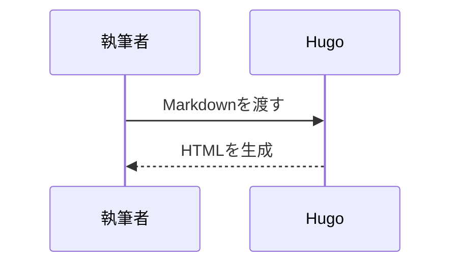
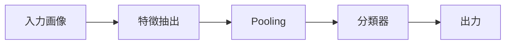

+++
aliases = ['/blog/technical-writing-check/']
title = '【動作確認用】技術記事の表示テスト'
date = '2026-10-24T13:28:32+09:00'
lastmod = '2026-10-24T13:28:32+09:00'
draft = false
math = true
tags = ['サンプル', 'KaTeX', 'Mermaid', 'Chroma']
categories = ['Programming']
description = '数式・コード・図・目次・全文検索の確認用記事です。研究成果や実験結果ではありません。'
summary = '技術記事向け機能の表示テスト。Python・C・Rust・Bash、KaTeX、Mermaidを確認できます。'
+++

> これはブログ機能の動作確認用記事です。コードは短い例、モデル構造は概念図であり、実験・開発の成果を示すものではありません。

---

## コードの表示とコピー

Python・C・Rust・BashをChromaでハイライトします。各コード右上の「コピー」で内容を取得できます。

### Python

```python
from math import sqrt

values = [1.0, 4.0, 9.0]
print([sqrt(value) for value in values])
```

### C

```c
#include <stdio.h>

int main(void) {
    puts("Hello, Slower!");
    return 0;
}
```

### Rust

```rust
fn main() {
    let values = [1, 2, 3];
    let sum: i32 = values.iter().sum();
    println!("sum = {sum}");
}
```

### Bash

```bash
for file in content/articles/*/index.md; do
    printf '%s\n' "$file"
done
```

### 長いコード

縦横のスクロールが記事全体に影響しないことを確認する例です。

```bash
printf '%s\n' 'スクロール確認 01 — long-content-long-content-long-content-long-content-long-content-long-content-long-content-long-content-long-content-long-content-long-content-long-content-'
printf '%s\n' 'スクロール確認 02 — long-content-long-content-long-content-long-content-long-content-long-content-long-content-long-content-long-content-long-content-long-content-long-content-'
printf '%s\n' 'スクロール確認 03 — long-content-long-content-long-content-long-content-long-content-long-content-long-content-long-content-long-content-long-content-long-content-long-content-'
printf '%s\n' 'スクロール確認 04 — long-content-long-content-long-content-long-content-long-content-long-content-long-content-long-content-long-content-long-content-long-content-long-content-'
printf '%s\n' 'スクロール確認 05 — long-content-long-content-long-content-long-content-long-content-long-content-long-content-long-content-long-content-long-content-long-content-long-content-'
printf '%s\n' 'スクロール確認 06 — long-content-long-content-long-content-long-content-long-content-long-content-long-content-long-content-long-content-long-content-long-content-long-content-'
printf '%s\n' 'スクロール確認 07 — long-content-long-content-long-content-long-content-long-content-long-content-long-content-long-content-long-content-long-content-long-content-long-content-'
printf '%s\n' 'スクロール確認 08 — long-content-long-content-long-content-long-content-long-content-long-content-long-content-long-content-long-content-long-content-long-content-long-content-'
printf '%s\n' 'スクロール確認 09 — long-content-long-content-long-content-long-content-long-content-long-content-long-content-long-content-long-content-long-content-long-content-long-content-'
printf '%s\n' 'スクロール確認 10 — long-content-long-content-long-content-long-content-long-content-long-content-long-content-long-content-long-content-long-content-long-content-long-content-'
printf '%s\n' 'スクロール確認 11 — long-content-long-content-long-content-long-content-long-content-long-content-long-content-long-content-long-content-long-content-long-content-long-content-'
printf '%s\n' 'スクロール確認 12 — long-content-long-content-long-content-long-content-long-content-long-content-long-content-long-content-long-content-long-content-long-content-long-content-'
printf '%s\n' 'スクロール確認 13 — long-content-long-content-long-content-long-content-long-content-long-content-long-content-long-content-long-content-long-content-long-content-long-content-'
printf '%s\n' 'スクロール確認 14 — long-content-long-content-long-content-long-content-long-content-long-content-long-content-long-content-long-content-long-content-long-content-long-content-'
printf '%s\n' 'スクロール確認 15 — long-content-long-content-long-content-long-content-long-content-long-content-long-content-long-content-long-content-long-content-long-content-long-content-'
printf '%s\n' 'スクロール確認 16 — long-content-long-content-long-content-long-content-long-content-long-content-long-content-long-content-long-content-long-content-long-content-long-content-'
printf '%s\n' 'スクロール確認 17 — long-content-long-content-long-content-long-content-long-content-long-content-long-content-long-content-long-content-long-content-long-content-long-content-'
printf '%s\n' 'スクロール確認 18 — long-content-long-content-long-content-long-content-long-content-long-content-long-content-long-content-long-content-long-content-long-content-long-content-'
printf '%s\n' 'スクロール確認 19 — long-content-long-content-long-content-long-content-long-content-long-content-long-content-long-content-long-content-long-content-long-content-long-content-'
printf '%s\n' 'スクロール確認 20 — long-content-long-content-long-content-long-content-long-content-long-content-long-content-long-content-long-content-long-content-long-content-long-content-'
printf '%s\n' 'スクロール確認 21 — long-content-long-content-long-content-long-content-long-content-long-content-long-content-long-content-long-content-long-content-long-content-long-content-'
printf '%s\n' 'スクロール確認 22 — long-content-long-content-long-content-long-content-long-content-long-content-long-content-long-content-long-content-long-content-long-content-long-content-'
printf '%s\n' 'スクロール確認 23 — long-content-long-content-long-content-long-content-long-content-long-content-long-content-long-content-long-content-long-content-long-content-long-content-'
printf '%s\n' 'スクロール確認 24 — long-content-long-content-long-content-long-content-long-content-long-content-long-content-long-content-long-content-long-content-long-content-long-content-'
printf '%s\n' 'スクロール確認 25 — long-content-long-content-long-content-long-content-long-content-long-content-long-content-long-content-long-content-long-content-long-content-long-content-'
printf '%s\n' 'スクロール確認 26 — long-content-long-content-long-content-long-content-long-content-long-content-long-content-long-content-long-content-long-content-long-content-long-content-'
printf '%s\n' 'スクロール確認 27 — long-content-long-content-long-content-long-content-long-content-long-content-long-content-long-content-long-content-long-content-long-content-long-content-'
printf '%s\n' 'スクロール確認 28 — long-content-long-content-long-content-long-content-long-content-long-content-long-content-long-content-long-content-long-content-long-content-long-content-'
printf '%s\n' 'スクロール確認 29 — long-content-long-content-long-content-long-content-long-content-long-content-long-content-long-content-long-content-long-content-long-content-long-content-'
printf '%s\n' 'スクロール確認 30 — long-content-long-content-long-content-long-content-long-content-long-content-long-content-long-content-long-content-long-content-long-content-long-content-'
printf '%s\n' 'スクロール確認 31 — long-content-long-content-long-content-long-content-long-content-long-content-long-content-long-content-long-content-long-content-long-content-long-content-'
printf '%s\n' 'スクロール確認 32 — long-content-long-content-long-content-long-content-long-content-long-content-long-content-long-content-long-content-long-content-long-content-long-content-'
printf '%s\n' 'スクロール確認 33 — long-content-long-content-long-content-long-content-long-content-long-content-long-content-long-content-long-content-long-content-long-content-long-content-'
printf '%s\n' 'スクロール確認 34 — long-content-long-content-long-content-long-content-long-content-long-content-long-content-long-content-long-content-long-content-long-content-long-content-'
printf '%s\n' 'スクロール確認 35 — long-content-long-content-long-content-long-content-long-content-long-content-long-content-long-content-long-content-long-content-long-content-long-content-'
printf '%s\n' 'スクロール確認 36 — long-content-long-content-long-content-long-content-long-content-long-content-long-content-long-content-long-content-long-content-long-content-long-content-'
printf '%s\n' 'スクロール確認 37 — long-content-long-content-long-content-long-content-long-content-long-content-long-content-long-content-long-content-long-content-long-content-long-content-'
printf '%s\n' 'スクロール確認 38 — long-content-long-content-long-content-long-content-long-content-long-content-long-content-long-content-long-content-long-content-long-content-long-content-'
printf '%s\n' 'スクロール確認 39 — long-content-long-content-long-content-long-content-long-content-long-content-long-content-long-content-long-content-long-content-long-content-long-content-'
printf '%s\n' 'スクロール確認 40 — long-content-long-content-long-content-long-content-long-content-long-content-long-content-long-content-long-content-long-content-long-content-long-content-'
printf '%s\n' 'スクロール確認 41 — long-content-long-content-long-content-long-content-long-content-long-content-long-content-long-content-long-content-long-content-long-content-long-content-'
printf '%s\n' 'スクロール確認 42 — long-content-long-content-long-content-long-content-long-content-long-content-long-content-long-content-long-content-long-content-long-content-long-content-'
printf '%s\n' 'スクロール確認 43 — long-content-long-content-long-content-long-content-long-content-long-content-long-content-long-content-long-content-long-content-long-content-long-content-'
printf '%s\n' 'スクロール確認 44 — long-content-long-content-long-content-long-content-long-content-long-content-long-content-long-content-long-content-long-content-long-content-long-content-'
printf '%s\n' 'スクロール確認 45 — long-content-long-content-long-content-long-content-long-content-long-content-long-content-long-content-long-content-long-content-long-content-long-content-'
printf '%s\n' 'スクロール確認 46 — long-content-long-content-long-content-long-content-long-content-long-content-long-content-long-content-long-content-long-content-long-content-long-content-'
printf '%s\n' 'スクロール確認 47 — long-content-long-content-long-content-long-content-long-content-long-content-long-content-long-content-long-content-long-content-long-content-long-content-'
printf '%s\n' 'スクロール確認 48 — long-content-long-content-long-content-long-content-long-content-long-content-long-content-long-content-long-content-long-content-long-content-long-content-'
printf '%s\n' 'スクロール確認 49 — long-content-long-content-long-content-long-content-long-content-long-content-long-content-long-content-long-content-long-content-long-content-long-content-'
printf '%s\n' 'スクロール確認 50 — long-content-long-content-long-content-long-content-long-content-long-content-long-content-long-content-long-content-long-content-long-content-long-content-'
```

---

## 数式

インライン数式：\(a^2 + b^2 = c^2\)。ドル記号形式の例：$E = mc^2$。

ブロック数式の例です。

$$
\operatorname{Attention}(Q,K,V) = \operatorname{softmax}\left(\frac{QK^\top}{\sqrt{d_k}}\right)V
$$

別のブロック区切りも使用できます。

\[
\begin{aligned}
f(x) &= x^2 \\
f'(x) &= 2x
\end{aligned}
\]

区切り記号はコード内では変換しません。例：`\(x_1 + x_2\)`。

---

## Mermaidの図

### フローチャート


### シーケンス図



### モデル構造の概念図

学習済みモデルや実験結果ではなく、処理の流れを示す簡略図です。



---

## 検索の確認

本文の後半にある日本語も検索対象です。確認用の語句として「画像認識の再現性」と「特徴抽出」を記載します。
英語の確認用語句はAttention mechanismです。記事の検索ページから試してください。

---

## 目次とアンカー

ページ上部の目次から各節へ移動できます。見出しの横にあるリンクからも同じ節を参照できます。
