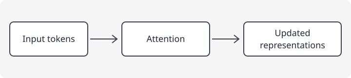

+++
aliases = ['/notes/deep-learning/transformer-basics/']
title = '【サンプル】Transformerの基礎'
date = '2026-10-24T09:00:00+09:00'
lastmod = '2026-10-24T13:22:36+09:00'
draft = true
tags = ["Transformer", "Deep Learning", "サンプル"]
categories = ["AI / Deep Learning"]
description = 'Transformerの学習ノートの書式例です。実際の学習成果の報告ではありません。'
summary = 'Transformerの学習ノートの書式例です。実際の学習成果の報告ではありません。'
+++

> これは記事構成と画像表示を確認するためのサンプルです。個人の研究成果や実験結果ではありません。

---

## 学習の目的

Transformerの構成要素を整理するノートの例です。ここでは文章の各トークンが、他のトークンの情報を参照して表現を更新する流れに注目します。

---

## 要点

- Attentionは、QueryとKeyの関連度に基づき、Valueの情報を重み付けして集約します。
- Self-Attentionでは、同じ入力系列からQuery・Key・Valueを作ります。
- 元論文の構成では位置情報を加え、Attentionと位置ごとのフィードフォワード層を組み合わせます。

以下は入力から表現更新までを単純化した概念図です。実際の層構造全体を示すものではありません。

---

## 確認したこと・未解決の疑問

学習時には系列長と計算量の関係、マスクの役割、位置情報の与え方などを追記できます。このサンプルでは実装や計測は行っていません。

---

## 参考資料

- [Attention Is All You Need（原論文）](https://arxiv.org/abs/1706.03762)
