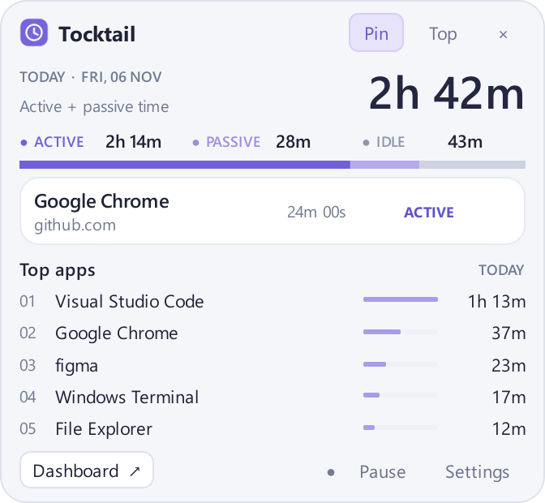

+++
title = 'tocktail'
date = '2026-11-07T00:00:00+09:00'
lastmod = '2026-11-07T00:00:00+09:00'
draft = false
math = false
tags = ['Python', 'PySide6', 'Windows', 'SQLite']
categories = ['Programming']
description = 'アプリやWebサイトの使用時間を記録・可視化する、Windows 11向けのローカルPC作業時間トラッカー。'
summary = 'Python・PySide6・SQLiteで開発したTocktailの紹介。トレイUI、使用時間の集計、ブラウザ連携と、記録をローカルで管理する設計をまとめる。'
+++

## 概要

Tocktailは、PCの使用状況を自動で記録・可視化するWindows 11向けのデスクトップアプリ。Pythonで開発しており、システムトレイから小さなポップアップを開いて、今日の使用時間や現在使っているアプリを確認できる。

アプリごとの使用時間をSQLiteに保存し、履歴ダッシュボードから日別の推移を振り返れる。Chrome・Edge向けの拡張機能と連携すると、条件を満たす範囲でWebサイトごとの時間も記録できる。



画面は[リポジトリ掲載のプレビュー](https://github.com/icchi5160/tocktail/blob/main/docs/assets/phase3-popup.png)で、表示されている時間や履歴はサンプルデータ。

---

## 開発のねらい

PCでどのアプリに時間を使っているかを記録し、作業時間を振り返れるようにすることを目指している。普段の作業を妨げないトレイ常駐型にし、必要なときだけ使用状況を確認できる構成にした。

活動記録を扱うため、データをローカルで管理することも重視している。記録対象を自分で選び、不要なアプリやサイトを除外できるようにしている。

---

## 主な機能

- **トレイとポップアップ**：今日の合計使用時間、状態別の内訳、現在のアプリと継続時間、使用時間上位5アプリを表示する。
- **履歴ダッシュボード**：1・7・30日分の日別グラフ、アプリ別・サイト別の集計、セッション一覧を確認できる。
- **ブラウザ連携**：Chrome・Edgeの拡張機能とNative Messaging Hostを使い、前面ウィンドウとの対応を確認できたサイトを記録する。
- **計測の制御**：一時停止・再開、アイドル判定の閾値、除外するアプリ・サイトを設定できる。
- **表示の調整**：ポップアップのピン留め、ドラッグ移動、最前面表示に対応している。
- **Windows起動時の自動起動**：トレイメニューから明示的に有効化できる。初期状態では無効にしている。

---

## 使用技術

| 技術 | 用途 |
| --- | --- |
| Python 3.12以上 | 計測・集計・保存処理の実装 |
| PySide6 Essentials | トレイ、ポップアップ、設定画面、ダッシュボード |
| Win32 API / ctypes | 前面ウィンドウ、最終入力時刻、ロック・電源通知の取得 |
| SQLite / sqlite3 | セッション・イベント・設定のローカル保存 |
| JavaScript / Manifest V3 | Chrome・Edge向けのブラウザ拡張機能 |
| Native Messaging / Windows Named Pipe | ブラウザ拡張機能とデスクトップアプリの通信 |
| uv / pytest / PyInstaller | 開発環境、テスト、Windows向けパッケージの作成 |

Windows APIの呼び出しにはPython標準ライブラリの`ctypes`を使っている。監視・集計・保存・画面表示を分け、計測の中心となる処理をOSやGUIから切り離した構成にしている。

---

## 使用時間の数え方

最後の入力から指定の閾値に達する前を`ACTIVE`、入力が一定時間なくても検証済みのブラウザの前面タブでメディア再生を確認できる状態を`PASSIVE`、入力が一定時間なく利用継続の根拠もない状態を`IDLE`として区別する。合計使用時間に加えるのは`ACTIVE`と`PASSIVE`だけで、一時停止・ロック・スリープなどの時間は含めない。

ブラウザ情報を取得できない場合や、複数ウィンドウの対応が曖昧な場合は、サイトを推測せずアプリ単位の計測に戻す。音が出ているだけで`PASSIVE`と判定することもしない。

異常終了後は、最後に保存した時点までを記録として扱う。再起動するまでの未観測時間を、使用時間として補完しないようにしている。

---

## 記録する情報を絞る

記録はローカルのSQLiteで管理する。キー入力の内容、入力文字列、マウス座標、個々の入力イベントは収集しない。ウィンドウタイトルの保存も初期状態では無効にしている。一方、計測対象のアプリのプロセス名と実行ファイルのパスは保存する。

ブラウザ拡張機能から送るURLはoriginまでに絞り、パス・検索語・認証情報などを送らない。DBにはドメインを保存し、URL全文は保存しない。シークレット／InPrivateやブラウザ内部ページの詳細も記録対象にしていない。

---

## 起動方法

Windows上でuvを導入し、リポジトリを取得した後、プロジェクトのルートで実行する。

```powershell
uv python install 3.12
uv sync --dev
uv run tocktail-desktop
```

ポップアップを閉じても計測は続く。アプリを終了するときは、トレイメニューの`Quit Tocktail`を選ぶ。

サイト別の記録には、これとは別にブラウザ拡張機能とNative Messaging Hostの導入が必要になる。設定方法は[ブラウザ連携の導入手順](https://github.com/icchi5160/tocktail/blob/main/docs/BROWSER_SETUP.ja.md)に記載している。

---

## 現在の状態

2026年11月7日時点では開発中のベータ版。トレイUI、履歴ダッシュボード、ブラウザ連携、Windows起動時の自動起動、ポータブルパッケージ作成の仕組みを実装している。

実際のChrome・Edgeへの拡張導入と接続、実機でのスリープ・ログオン、クリーンPCでの動作、実時間での24時間連続運転など、リリースに向けた確認は残っている。パッケージ作成への対応と、配布用バイナリの正式公開は分けて扱っている。

---

## GitHubリポジトリ

[icchi5160/tocktail](https://github.com/icchi5160/tocktail)

詳しい操作方法や検証状況は、[日本語README](https://github.com/icchi5160/tocktail/blob/main/README.ja.md)に記載している。
